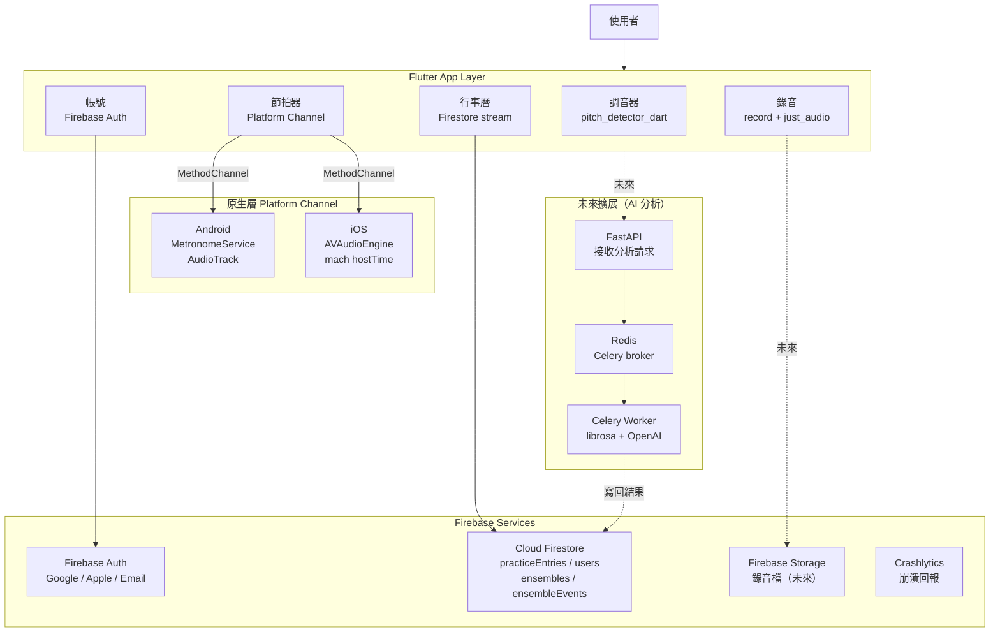
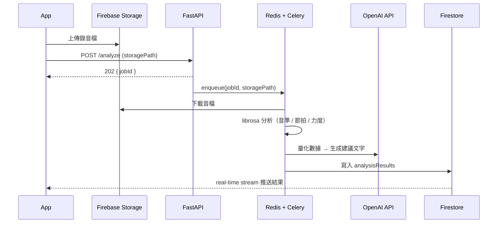

# 🎺 管樂手帳（Wind Musician）

[](https://flutter.dev)
[](https://firebase.google.com)
[]()

> 專為管樂演奏者設計的全方位練習工具，支援 Android 與 iOS。

---

## 目錄

- [專案動機](#專案動機)
- [系統架構](#系統架構)
- [技術選型](#技術選型)
- [核心設計：節拍器 Platform Channel](#核心設計節拍器-platform-channel)
- [後端架構設計](#後端架構設計)
- [Firestore 資料模型](#firestore-資料模型)
- [功能概覽](#功能概覽)
- [未來規劃與技術設計](#未來規劃與技術設計)
- [快速啟動](#快速啟動)
- [靜態分析與測試](#靜態分析與測試)
- [版本紀錄](#版本紀錄)

---

## 專案動機

管樂手帳的設計初衷來自一個真實的痛點：市面上的節拍器 App 在高 BPM 下節拍漂移，而調音器 App 不支援移調樂器，練習記錄又散落在不同工具裡。

這個專案試圖回答以下問題：

- 如何在 Flutter 框架上實現毫秒級精準的節拍器？（答案是原生 Platform Channel，不是 Dart Timer）
- 如何設計一個在離線狀態下仍然可用的雲端同步 App？
- 在個人 side project 的規模下，Firebase BaaS 是否是比自架 Server 更合理的選擇？

---

## 系統架構

```
┌──────────────────────────────────────────────────────────────┐
│                    Wind Musician App                         │
│               Flutter 3.x / Riverpod / go_router            │
└────┬──────────┬──────────┬──────────┬────────────┬──────────┘
     │          │          │          │            │
     ▼          ▼          ▼          ▼            ▼
 ┌────────┐ ┌────────┐ ┌────────┐ ┌────────┐ ┌────────────┐
 │調音器  │ │節拍器  │ │ 音叉  │ │ 錄音  │ │  行事曆    │
 │(Dart + │ │(原生   │ │(Dart) │ │(record│ │(Firestore) │
 │pitch   │ │Channel)│ │       │ │+audio)│ │            │
 │detect) │ │        │ │       │ │       │ │            │
 └────────┘ └───┬────┘ └────────┘ └───┬───┘ └─────┬──────┘
                │                     │            │
     ┌──────────┴──────┐               │            │
     │                 │               │            │
     ▼                 ▼               ▼            ▼
 ┌─────────┐     ┌──────────┐   ┌─────────────────────────┐
 │ Android │     │   iOS    │   │     Firebase Services    │
 │Metronome│     │Metronome │   ├──────────┬──────────────┤
 │Service  │     │Engine    │   │   Auth   │  Firestore   │
 │(AudioTr)│     │(AVAudio) │   │ Storage  │ Crashlytics  │
 └─────────┘     └──────────┘   └──────────┴──────────────┘
```



---

## 技術選型

| 元件 | 選擇 | 原因 |
|------|------|------|
| UI Framework | Flutter 3.x | 單一 codebase 同時支援 Android / iOS，原生 Platform Channel 保留效能逃生口 |
| 狀態管理 | Riverpod ^2.6.1 | 編譯期型別安全，Provider 間依賴明確，易於測試 |
| 路由 | go_router ^14.0.0 | 宣告式路由，支援 deep link，符合 Flutter 官方推薦 |
| 後端 | Firebase BaaS | 個人 side project 規模，BaaS 省去維運成本，可集中精力在 App 體驗 |
| 資料庫 | Cloud Firestore | real-time stream 驅動 UI，離線快取內建，Security Rules 取代 API 層授權 |
| 音高偵測 | pitch_detector_dart | 即時 FFT 分析，支援移調計算，無需後端 |
| 節拍引擎 | 原生 Platform Channel | Dart Timer 精度不足（±5–10ms），原生音訊引擎可達 ±1ms 以內 |
| 多語系 | ARB + flutter_localizations | 官方方案，支援 zh / en / ja / ko 四語系 |

---

## 核心設計：節拍器 Platform Channel

### 為什麼不用 Dart Timer

Dart 的 `Timer` 受 event loop 影響，在高 BPM（如 200+）下誤差可達 ±5–10ms，累積後節拍明顯漂移，對音樂練習場景不可接受。

解決方案是透過 `MethodChannel('metronome')` 將節拍控制完全交給原生層，Dart 只負責 UI 與參數傳遞。

### 執行流程

```
Flutter（Dart）
  └─ MethodChannel('metronome')
        ├─ start(bpm, beatsPerBar, subdivision)
        ├─ stop()
        └─ updateBpm(bpm)
             │
             ├─ Android
             │    └─ MetronomeService（前景服務，確保背景持續播放）
             │         └─ MetronomeEngine（AudioTrack 合成正弦波）
             │              └─ AudioFocusHandler（接管音訊焦點）
             │
             └─ iOS
                  └─ MetronomePlugin.swift（MethodChannel bridge）
                       └─ MetronomeEngine.swift
                            └─ AVAudioEngine + mach_absolute_time()
                                 └─ hostTime 精準排程，±1ms 以內
```

### Android 前景服務設計

Android 系統在 App 進入背景後可能終止進程，節拍器因此停止。解法是將 `MetronomeService` 宣告為 Foreground Service，系統不能隨意回收，並在通知欄顯示節拍器狀態，符合 Android 8.0+ 的背景執行限制。

### iOS mach hostTime 精準排程

iOS 的 `AVAudioEngine` 支援 `playerNode.play(at:)` 以 `AVAudioTime` 排程播放時機，搭配 `mach_absolute_time()` 計算絕對時間點，每一拍的音效都在精確的時間點被 schedule，不依賴 Timer 回呼的延遲。

---

## 後端架構設計

### 為什麼選擇 Firebase BaaS

本專案刻意選擇 Firebase 作為後端，而非自架 API Server。這是明確的架構取捨，不是技術能力的限制。

管樂手帳是個人練習工具，核心價值在於 App 體驗與音訊正確性，而非後端系統設計。Firebase 提供的 Auth、Firestore、Storage、Crashlytics 覆蓋所有現有需求，BaaS 模式讓開發速度快一個數量級，且維運成本為零。

當功能擴展到需要自訂運算邏輯（如 AI 演奏分析）時，不需要重構現有架構，只需在 Firebase 外側追加獨立的後端服務，兩者透過 Firestore 作為資料介面串接。

### 身份驗證設計

支援三種登入方式：Google、Apple Sign-In、Email/Password。

Apple Sign-In 並非選配——App Store 審查規範 4.8 要求，只要 App 提供任何第三方社交登入，就必須同時提供 Apple Sign-In。

```
用戶點擊登入
  → Google / Apple / Email 認證流程
    → Firebase Auth 取得 credential
      → _upsertUser()
           ├─ 首次登入 → createUser（寫入 Firestore users/{uid}）
           └─ 再次登入 → updateLastActive（只更新時間戳，不覆蓋用戶資料）
```

### 資料存取模式

Firestore 查詢依使用情境分兩種模式：

**一次性 fetch**（`getEntriesForMonth`）：用於初始載入，取得特定月份資料後不再訂閱，降低 Firestore 讀取計費。

**Real-time stream**（`watchEntriesForMonth`）：用於需要即時反映的 UI（行事曆），透過 Riverpod `StreamProvider` 直接驅動畫面更新，Firestore SDK 內建連線恢復後自動重訂閱。

### 離線設計

練習紀錄同時寫入 Firestore 與本機 JSON 檔案（`practice_entries.json`）。

```
saveEntry(entry)
  ├─ Firestore.set(entry) ─── 成功 ──────────────────────→ 完成
  │                       └─ FirebaseException ─→ throw
  └─ _upsertLocal(entry) ──── 本機 JSON 備份 ────────────→ 完成

watchEntriesForMonth()
  ├─ Firestore stream ─── 正常 ──→ UI 即時更新
  └─ FirebaseException ── handleError ─→ 靜默處理，保留最後一次成功的資料
                                         連線恢復後 provider 自動重建重新訂閱
```

這樣設計的結果是：Firestore 離線時 App 不會白屏或崩潰，已載入的資料繼續顯示，新增的資料寫入本機，等連線恢復後由用戶決定是否補同步。

---

## Firestore 資料模型

```
users/
  └─ {uid}/
       ├─ displayName: string
       ├─ email: string
       ├─ photoUrl: string
       ├─ createdAt: timestamp
       └─ lastActiveAt: timestamp

practiceEntries/
  └─ {entryId}/
       ├─ userId: string
       ├─ date: string (ISO 8601)
       ├─ duration: number (minutes)
       └─ content: string

ensembles/
  └─ {ensembleId}/
       ├─ name: string
       ├─ memberIds: string[]
       └─ createdAt: timestamp
            └─ events/
                 └─ {eventId}/
                      ├─ title: string
                      ├─ date: string
                      └─ location: string
```

### Security Rules 設計原則

- `users/{uid}`：只有 `request.auth.uid == uid` 才可讀寫，防止用戶存取他人資料
- `practiceEntries`：`where('userId', isEqualTo: uid)` 查詢搭配 Rules 的 `resource.data.userId == request.auth.uid` 確保資料隔離
- `ensembles`：`memberIds.hasAny([request.auth.uid])` 確認成員身份才可讀取群組行程

---

## 功能概覽

### 已上線功能

**🎵 調音器**
即時音高偵測（麥克風輸入），支援 12 種管樂器移調（Bb / Eb / F / C），基準音高可調整（A4 = 400–480 Hz）。顯示音名、分音差（cents）及準確 / 偏高 / 偏低狀態。

**🥁 節拍器**（整合於調音器頁面）
BPM 20–320，多拍型拍號（分子 1–12 / 分母 1–32），強拍提示音，段落練習模式。Android 與 iOS 使用原生 Platform Channel 確保精準節拍（詳見[核心設計](#核心設計節拍器-platform-channel)）。

**🎹 音叉（PitchFork）**
六角蜂巢排列 12 音鍵盤，支援 Sustain 持續音模式（長按保持），旋轉手勢切換八度。

**🎙️ 錄音**
高品質錄音與播放，資料夾分類管理，重新命名 / 刪除 / 匯出分享，最長 15 分鐘，支援搜尋。

**📅 行事曆**
個人練習日誌，依日期紀錄練習時長與內容，月曆圓點標記，登入後可存取樂團群組行程。

**📖 音樂術語查詢**
本地離線資料庫，多語系術語解釋，快速標籤一鍵查詢常用術語。

**🐛 問題回報**
App 內一鍵開啟郵件 App，自動帶入版本號與平台資訊。

**👤 帳號**
Google / Apple / Email 登入，Firebase Auth。

### 開發中功能

| 功能 | 狀態 |
|------|------|
| AI 演奏分析 | 架構建立，串接中 |
| 行程規劃 | 頁面架構建立，功能開發中 |
| 社群（好友動態、排行榜）| 規劃中 |
| 樂譜瀏覽 / Score Following | 第二版實作 |

---

## 未來規劃與技術設計

### AI 演奏分析

**功能目標**：用戶錄音後，系統自動分析音準準確率、節拍穩定度、力度曲線，並生成自然語言的練習建議。

**為什麼需要獨立後端**：音訊分析涉及 `librosa`、`numpy` 等 Python 生態的運算，且單次分析可能耗時 10–30 秒。Firebase Cloud Functions 有 9 分鐘 timeout 與 512MB 記憶體限制，Python runtime cold start 體驗差，不適合作為分析主體。

**技術選型**：

| 元件 | 選擇 | 原因 |
|------|------|------|
| API Framework | FastAPI | async 支援，自動生成文件，型別提示完整 |
| 任務佇列 | Celery + Redis | 分析任務非同步執行，API 立即回傳 jobId，不讓 HTTP request 等待 |
| 音訊分析 | librosa | 音高統計、onset detection、RMS energy 計算 |
| 建議生成 | OpenAI API | 將量化數據轉為自然語言練習建議 |
| 部署 | Railway / Fly.io | 無需管理 VM，免費額度適合 side project |

**完整流程**：

```
App 錄音完成
  → 上傳至 Firebase Storage
  → POST /analyze（送 storage path）
       → FastAPI 回傳 jobId（立即）
       → Celery Worker 非同步處理
            ├─ 下載音檔
            ├─ librosa 分析
            │    ├─ 音準準確率：每幀音高 vs 目標音高，統計 ±20 cents 內比例
            │    ├─ 節拍穩定度：onset detection 計算每拍誤差標準差
            │    └─ 力度曲線：RMS energy 時間序列
            ├─ 量化數據 → OpenAI API → 自然語言建議
            └─ 寫回 Firestore（analysisResults/{userId}/{jobId}）
  → App real-time stream 收到更新，顯示分析報告
```



---

### 行程規劃

**功能目標**：個人練習排程（含提醒）、樂團成員共用行程。

**技術設計**：
- 個人行程與樂團行程分別存於 Firestore `schedules` 和 `ensembleEvents` collections
- 提醒推播透過 Firebase Cloud Messaging（FCM），觸發點使用 Cloud Functions scheduled trigger（文件到期前 X 小時）
- 純 Firebase 實現，不需要自架 server

---

### 社群功能（好友動態、排行榜）

**功能目標**：好友練習動態 feed、每月練習時長排行榜。

**技術設計**：

```
好友關係
  friendships/{userId_friendId}
    ├─ status: pending | accepted
    ├─ fromId: string
    └─ toId: string

動態 Feed（Fanout-on-write）
  用戶新增練習紀錄
    → 同時寫入所有好友的 feed/{friendId}/items/{entryId}
    → 每個用戶 feed 查詢只讀自己的 sub-collection，不需要 join

排行榜
  leaderboard/{month}/{userId}
    └─ monthlyMinutes: number
  → Cloud Functions 每月 1 日重置，每次 saveEntry 累加
```

**取捨說明**：Fanout-on-write 在好友數極多時（1000+）寫入成本高。管樂社群是小圈子產品，預期好友數在數十人以內，此策略在現階段合理，未來若用戶規模擴大可改用 Pull-on-read 搭配 Cache。

---

### 樂譜瀏覽 / Score Following

**短期（靜態翻頁）**：
- PDF 樂譜存於 Firebase Storage，metadata 存 Firestore
- App 端 `pdfx` 套件渲染，依 BPM × 小節數計算自動翻頁時機
- 純 Firebase，不需要後端

**長期（Score Following）**：
- 即時比對演奏音訊與樂譜時間軸，核心演算法為 DTW（Dynamic Time Warping）
- 計算量遠超 on-device 能力，需後端串流處理（WebSocket）
- 此功能列為長期研究方向，目前優先實作靜態翻頁版本

---

## 快速啟動

### 前置需求

- Flutter SDK `^3.x`（建議使用 FVM 管理版本）
- Firebase 設定檔（**不含於版本控制**，請自行從 Firebase Console 下載）：
  - Android：`android/app/google-services.json`
  - iOS：`ios/Runner/GoogleService-Info.plist`

### 執行步驟

```bash
# 安裝相依套件
flutter pub get

# 啟動 App（debug 模式）
flutter run -d android
flutter run -d ios
```

### Android Release 打包

Release 打包需要簽名金鑰（**不含於版本控制**）：

- `android/key.properties`
- `android/app/wind_musician.jks`

### 發布測試版（Firebase App Distribution）

```powershell
.\distribute.ps1 -ReleaseNote "更新說明"
```

腳本自動執行：`flutter build apk --release` → 上傳 Firebase → 通知測試人員。

---

## 靜態分析與測試

```bash
# 靜態分析（應無 error）
flutter analyze

# 執行測試
flutter test
```

### 測試涵蓋範圍

| 測試檔案 | 說明 |
|---------|------|
| `test/features/metronome/metronome_boundary_test.dart` | 節拍器邊界條件 |
| `test/features/metronome/metronome_test.dart` | 節拍器核心邏輯 |
| `test/features/recorder/recorder_notifier_test.dart` | 錄音狀態管理 |
| `test/features/tuner/tuner_notifier_test.dart` | 調音器狀態管理 |
| `test/shared/services/native_channel_test.dart` | Platform Channel |

---

## 專案結構

```
lib/
├── features/
│   ├── tuner/          # 調音器（含節拍器、音叉）
│   ├── recorder/       # 錄音
│   ├── calendar/       # 行事曆 / 練習日誌
│   ├── terminology/    # 音樂術語
│   ├── guide/          # 使用說明
│   └── auth/           # 登入 / 認證
├── shared/
│   ├── services/       # 共用服務（Platform Channel 等）
│   ├── theme/          # 主題 / 色彩
│   └── widgets/        # 共用元件（AppDrawer 等）
└── l10n/               # 多語系 ARB
    ├── app_zh.arb      # 繁體中文（範本）
    ├── app_en.arb
    ├── app_ja.arb
    └── app_ko.arb
```

---

## 版本紀錄

### v1.0.1+2（目前版本）
- 問題回報功能（寄信，含版本自動偵測、完整錯誤處理）
- 麥克風權限流程修復（iOS 系統對話框 → 使用者主動前往設定）
- Sustain 按鈕手勢衝突修復
- UI 溢位修復、切換拍號自動回第一拍
- iOS 原生節拍器（AVAudioEngine）

### v1.0.0+1
- 初始版本，核心功能上線

---

## License

本專案採用 [MIT License](LICENSE)。
